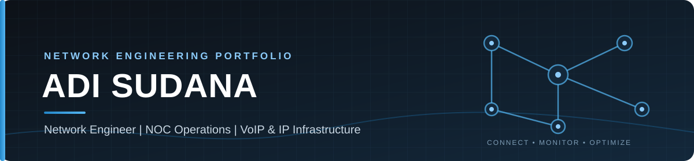

  

# Adi Sudana — Network Engineering Portfolio

A portfolio focused on Network Operations, IP networking, routing, VoIP infrastructure and practical automation.

## Website files
- `index.html` — portfolio content
- `styles.css` — responsive styling
- `script.js` — mobile navigation and footer year
- `assets/banner.svg` — locally stored portfolio banner

## Evidence and accuracy
The APNIC WHOIS section is based on record text supplied for this portfolio. It presents the registered contact association as supporting evidence, not as proof of network ownership or of every configuration activity.

Private contact details are intentionally omitted. Customer identifiers, credentials, private IP information and confidential network diagrams must not be published.

## Project status
The MikroTik monitoring and BGP case-study summaries are preliminary. Implementation details, scripts, test evidence and outcomes will be added only after source material is reviewed.

## Preview
Open `index.html` in a browser, or deploy this static site with GitHub Pages from the `main` branch and repository root.
